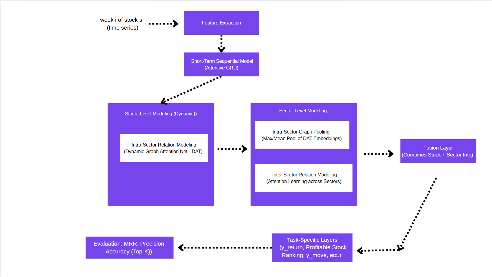

In modelstruct.ipynb ,you can check what is store inside the  'best_model_dim32.pt' like complete architecture of the model,weights 
stored during the training time .

FINDAT -
How to run this directory to get the FINDAT model-

Step 1-Run data_collection .py 
    Input for this is ind_nifty500list_filtered_final-1.csv file
    Output: The data of past year stored in data/cleaned directory (start date and end date - 10-1-22 to 10-1-25)

Step 2: Run preprocess.py 
      In this we add the additional features ,apply sliding window ,and split the each stock data into train,val,test
      Input:data/cleaned
      Output:We get adj_matrix.npy,sector_mapping.csv, data/processed and data/windows   directory .

Step3: Run train.py 
     In this , train the model
     I run this model for GRU dim=[8,16,32,64] and I got the best model for [32] gru dim

After training we the best model saved in .pt format in the checkpoints directory .

For New data from 11-1-25 to 10-4-25

In the 'DataFromJanToApril' directory we have the new data from 11-1-25 to 10-4-25

Step4- Run the AblationCode.py file
 After running we get the instance metric and daily predicated ranks for each day in each csv files

       
      
    

## Corrected ranking loss (Nov 2026)

The original training loop used `FinGAT.calculate_loss`, whose ranking term only
adds label values (`|true_diff|`) for mis-ordered pairs, so its gradient with
respect to the predictions is zero and the return head never learned to rank.
Training now uses `FinGAT.ranking_movement_loss`: a vectorized, differentiable
pairwise hinge (`relu(margin - sign(true_diff) * pred_diff) * |true_diff|`)
plus the movement BCE.

`python train_fixed_loss.py --epochs 15 --dims 8 16 32 64` retrains the
hidden-size ablation, selects each model on validation MRR@5, and reports test
metrics next to a random-ranking baseline (`results/fixed_loss_metrics.json`,
checkpoints in `checkpoints/fixed_loss/`; the original checkpoints are kept).

Test set (~180 trading days, 445 stocks; random Precision@5 is about 5/445 = 1.1%):

| Model | Precision@5 | Precision@10 | Precision@20 | MRR@5 | IRR@5 (lower is better) |
|---|---|---|---|---|---|
| Random ranking | 0.91% | 2.05% | 4.43% | 0.0154 | 0.452 |
| GRU dim 8 | 1.25% | 2.73% | 5.60% | 0.0145 | 0.447 |
| GRU dim 16 | 1.36% | 2.39% | 4.55% | 0.0159 | 0.448 |
| GRU dim 32 | 1.59% | 2.50% | 5.31% | 0.0174 | 0.444 |
| GRU dim 64 | 1.93% | 2.67% | 5.48% | 0.0180 | 0.447 |

The models rank slightly better than chance. Next-day returns are close to a
random walk, so this is a learning-to-rank research baseline, not a trading
signal (no transaction-cost back-test).
